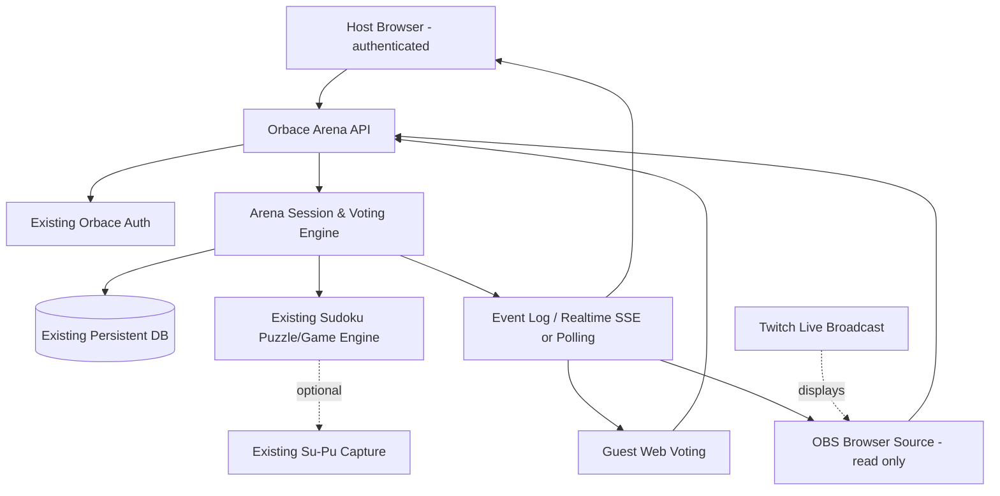

# Orbace Sudoku Arena (擂台) — Pilot RPD & Architecture Design
**Version:** 0.1 | **Date:** 2026-10-28 | **Status:** Approved product scope; architecture for review | **Target:** 3 development days after infrastructure readiness

## 1. Executive decision
Build **Challenge Show Lite**: a streamer hosts a timed Sudoku round; anonymous audience members vote on a difficulty/time preset, watch the streamer solve, and cast one optional audience-strike vote. The host wins if the Sudoku is solved correctly before the deadline; otherwise the audience wins. Offer immediate rematch. Twitch is a broadcast/discovery channel, not a required identity provider or source of truth. The same Orbace web session works for viewers arriving from other platforms.

**Distinct from Reddit Help to Solve:** viewers do **not** submit candidate moves, solve the board collectively, or provide hints. They control challenge conditions, not puzzle logic. **Distinct from official Orbace rankings:** unranked entertainment session, no Ranking Points, Scorecard, competition enrollment, or prizes.

### 1.1 Explicit MVP boundaries
**Include:** one authenticated Orbace host; public share URL/QR; anonymous voting; three fixed challenge presets; one strike vote; server-authoritative state and timer; host Sudoku board; read-only OBS overlay; result/rematch; basic event log; operational metrics and kill switch.

**Exclude:** Twitch OAuth/API/EventSub, native Twitch Extension, Twitch chat bot, Twitch polls, payments, leaderboards, viewer gameplay, side-by-side Su-Pu, AI generation, multi-host, multi-platform SDKs, and full replay renderer. Existing Su-Pu must not be broken.

### 1.2 Proposed rules — configurable pilot defaults
- Preset vote: 20 seconds; **Easy Sprint** (Easy, 180s), **Medium Match** (Medium, 300s), **Hard Survival** (Hard, 480s). Presets are *illustrative tuning values*; host may override only before vote starts, using predefined options.
- If no votes: host-selected default preset; ties: fixed deterministic priority displayed to host and participants (or seeded selection stored in session); do not silently choose.
- One audience-strike vote opens once after 30% of initial clock duration, for 15 seconds. Options: **Activate No Notes (20 seconds)** / **Spare the Streamer**. Highest vote wins; ties default to Spare; zero votes default to Spare.
- Notes effect hides candidate-note rendering and entry temporarily, preserving notes data; the board and givens never change. If existing board cannot support it safely, **fallback** is a 10-second clock deduction with a 30-second minimum remaining time, applied once; label this change prominently in UI and telemetry.
- Each participant can vote once per ballot, may change vote until close (last valid choice counts). Anonymous cookie/device identifier reduces duplication but does not guarantee one person = one vote.
- Host can pause only for technical problems; pauses freeze authoritative clock and scheduled votes, are visibly labeled, and are logged. Host may cancel; cancellation has no winner. A disconnect does not automatically pause the round.
- Winning requires Sudoku grid fully valid against the puzzle's authoritative solution before server deadline. No client-side victory decision. Server timestamps control all deadlines.
- Session states: CREATED → PRESET_VOTE → READY → PLAYING → STRIKE_VOTE → PLAYING → FINISHED / CANCELLED. `PAUSED` is a substate of PLAYING/STRIKE_VOTE with frozen effective time. A session cannot move backward.
- Pilot limit: one active Arena session per host, maximum 50 simultaneous audience participants as initial *load-test target*, not guaranteed capacity.

## 2. Personas and journeys
**Host:** signs into Orbace with an existing authenticated account, opens Arena dashboard, selects preset pool, starts audience vote, shares public link, starts game, solves, watches overlay, reviews result, starts rematch.

**Audience voter:** opens `/arena/s/{id}` in a browser, receives anonymous first-party session cookie, votes on preset, sees aggregate counts after vote close, watches progress and optionally votes on one strike; no Twitch/Orbace account required. Accessibility: buttons and timers keyboard usable, non-color-only state, mobile viewport.

**Spectator:** watches Twitch without visiting Orbace, sees board, timer, vote status, winning outcome through OBS overlay. Voting requires opening Orbace participation link; Twitch chat alone does not cast votes.

**Operator:** can disable feature flag, inspect session health, revoke a host session, and identify abusive voting patterns without accessing personal identities unnecessarily.

### 2.1 Primary end-to-end acceptance journey
Host creates session → 3 browsers join → preset vote opens/closes → selected preset and puzzle fixed → host starts synchronized clock → host enters Sudoku values → one strike vote occurs → winning effect activates/expires → host solves or times out → authoritative result displayed everywhere → host creates rematch with new puzzle → prior event log retained.

### 2.2 Failure and abuse cases
- Late or duplicate votes: HTTP 409 for closed ballots; upsert within open ballot for same guest identity.
- Race between ballot closing and last vote: transactional cutoff on server time.
- Stale host commands: version conflict 409; refresh and retry.
- Browser refresh or reconnect: re-fetch authoritative snapshot; never reconstruct timer from local countdown.
- OBS reload: read-only snapshot and live event stream, no secrets embedded in URL.
- Puzzle data mismatch: fail closed; do not launch.
- Host disappears: round continues by default; operator/host may cancel; no auto-award except deadline expiry.
- Abusive votes: per-IP and per-cookie rate limits; do not claim robust Sybil resistance without authenticated identity.
- Malicious content: no free-text viewer inputs in pilot.

## 3. Architecture



**Deployment recommendation:** Add Arena routes and services to the existing Orbace web/backend deployment; reuse current database and hosting. Do not provision Redis, queues, or a separate microservice unless repository inspection proves necessary. Use server-sent events if supported by hosting; otherwise poll state every 2–3 seconds with ETag/version. OBS may be an HTML page hosted at the same domain.

**Platform expansion hook:** `sourcePlatform` enum/string on sessions (`web`, `twitch`, `youtube`, `discord`, `reddit`, `other`), optional `externalChannelId`, and an interface `PlatformAdapter { buildShareUrl(session): string; formatAnnouncement(session): string }`. Initial implementation is only a web-link adapter. No external platform credentials in MVP.

### 3.1 Logical modules
- `arena-session`: lifecycle, host authorization, server deadlines, pause/cancel/rematch, optimistic versioning.
- `arena-ballot`: choices, cutoff, idempotent votes, deterministic tally and tie resolution.
- `arena-modifier`: bounded No Notes effect; fallback time penalty; active/expired transitions.
- `arena-game`: adapter to existing Sudoku puzzle selection, authoritative givens/solution, host move validation, solved detection.
- `arena-events`: append-only audit stream for session transitions, votes aggregated (not voter identity), modifier changes, game finish.
- `arena-web`: host UI, guest voting UI, overlay UI; all use same session snapshot contract.

### 3.2 Persistence schema (conceptual; adapt to existing conventions)
`arena_sessions(id UUID PK, host_user_id, source_platform, external_channel_id NULL, status, paused, preset_id NULL, puzzle_given_hash, puzzle_snapshot_ref, started_at, deadline_at, remaining_ms_on_pause, winner NULL, version INT, created_at, updated_at)`

`arena_ballots(id UUID PK, session_id FK, kind PRESET|STRIKE, opens_at, closes_at, status, resolved_choice, version)`

`arena_votes(ballot_id FK, guest_key_hash, choice_id, updated_at, PRIMARY KEY(ballot_id,guest_key_hash))`

`arena_events(id UUID PK, session_id FK, seq INT, type, payload JSON, created_at, UNIQUE(session_id,seq))`

`arena_game_state(session_id PK, board_snapshot, notes_snapshot, revision, updated_at)` — prefer existing game state storage when safe.

**Indexes:** sessions(host_user_id,status); ballots(session_id,status); events(session_id,seq). Retain pilot session/event data for 30 days by default; review legal/privacy policy and operational requirements before production. Store only hashed anonymous identifiers where possible.

## 4. API contract v0.1 (proposed, not existing endpoints)
All routes are under `/api/arena`. JSON errors `{code,message,requestId}`; mutating requests support `Idempotency-Key` where relevant; server state carries `version`, `serverNow`, and effective deadlines. Host commands require existing Orbace session + CSRF protection; guest voting requires secure SameSite first-party cookie, rate limiting and Origin validation.

| Method | Route | Caller | Purpose |
|---|---|---|---|
| POST | `/sessions` | Host | Create session and default ballot configuration |
| GET | `/sessions/{id}` | Public | Safe snapshot: phase, preset, public board state, vote state, clock, result |
| POST | `/sessions/{id}/preset-vote/open` | Host | Start preset vote |
| POST | `/sessions/{id}/votes` | Guest | Cast/change vote `{ballotId,choiceId}` |
| POST | `/sessions/{id}/start` | Host | Resolve preset, lock puzzle, start game |
| POST | `/sessions/{id}/moves` | Host | Apply Sudoku entry `{cell,digit,expectedRevision}` |
| POST | `/sessions/{id}/pause` | Host | Technical pause |
| POST | `/sessions/{id}/resume` | Host | Resume |
| POST | `/sessions/{id}/cancel` | Host | Cancel round |
| POST | `/sessions/{id}/rematch` | Host | Create new session linked to prior session |
| GET | `/sessions/{id}/events?after={seq}` | Public | Sanitized event log or stream; no guest identifiers |
| GET | `/sessions/{id}/overlay` | Public | HTML OBS overlay (or use web route) |

**Critical semantics:** Ballot open/close and timeout must be computed server-side; client countdown is presentation only. `POST /votes` uses atomic UPSERT, rejects closed ballot; `POST /moves` must be serialized or use revision compare-and-swap. Any valid board solution submitted after deadline loses. Ensure event log publication follows successful DB commit. Avoid revealing hidden solution/candidates in public API.

**Example public session snapshot**
```json
{
  "id":"session-uuid", "status":"PLAYING", "version":12,
  "serverNow":"2026-10-28T17:00:00Z",
  "deadlineAt":"2026-10-28T17:05:00Z",
  "preset":{"id":"medium-match","difficulty":"medium","durationSeconds":300},
  "ballot":{"id":"ballot-uuid","kind":"STRIKE","closesAt":"2026-10-28T17:01:00Z","choices":["no-notes","spare"]},
  "activeModifier":null,"winner":null
}
```

## 5. Infrastructure and account setup — do this immediately
### 5.1 REQUIRED for three-day MVP
| System/account | Owner action | Values to capture | Secret? | Required day |
|---|---|---|---|---|
| Orbace GitHub/repository | Give Codex access to existing web/backend repos and test scripts; create feature branch | Repository path, build/test commands, deployment branch | Existing repo access credentials remain private | 0 |
| Orbace hosting | Confirm existing runtime supports server API, persistent storage, and long polling/SSE if chosen | Hosting provider, environment names, deploy URL, runtime limits | Deployment token: YES | 0 |
| Orbace database | Confirm existing DB and migration access; create migration in existing pipeline | DB engine/version, migration tool, backup/restore plan | Connection string: YES | 0 |
| Orbace authentication | Identify existing host sign-in and admin/feature flag pattern | Auth/session mechanism, host allowlist | Auth signing secret: YES | 0 |
| Public HTTPS domain | Use existing `orbacesudoku.com/arena` paths; no new DNS required if routes available | HTTPS routing, canonical URL, CDN cache bypass on API | TLS managed by host | 1 |
| OBS Studio | Install on streamer machine; configure Browser Source | 1920×1080 scene; overlay URL; window capture source | Stream key: YES if required | 2 |
| Twitch broadcaster account | Verify email, enable 2FA where prompted, configure streaming channel and category/title | Channel URL, stream title, broadcast test access | Twitch password/stream key: YES | 2 |
| Logging/monitoring | Reuse existing application logs/error tracker | Error rate, active sessions, vote failures, API latency | Monitoring DSN/token if private | 2 |

**Security:** Never paste stream keys, database URLs, OAuth secrets, or deployment tokens into a Codex prompt, GitHub issue, public chat, or committed `.env`. Use existing deployment secret manager. Maintain `.env.example` with placeholders only.

### 5.2 NOT REQUIRED for MVP — optional future Twitch API integration
**Twitch Developer Console:** https://dev.twitch.tv/console/apps. Register an application only when implementing Twitch OAuth, chat bot, EventSub, native polls, or other API functionality. Twitch developer registration requires a verified Twitch account and 2FA. Capture client ID; client secret stays in backend secret manager. Define callback URL only for an OAuth flow actually implemented. Do not request scopes preemptively. Official reference: https://dev.twitch.tv/docs/authentication/register-app/ .

**Future EventSub:** needs selected subscription type, proper OAuth token/scopes, webhook callback and signature verification or WebSocket listener. Not part of pilot. Reference: https://dev.twitch.tv/docs/eventsub/ .

**Future YouTube/Discord/Reddit:** no developer account, OAuth app, webhook, or API keys necessary now. Future adapters should only add distribution or identity bindings, never fork core Arena game logic.

### 5.3 OBS setup steps
1. Install OBS Studio from https://obsproject.com/ and connect a Twitch account or configure Twitch stream key privately.
2. Create scene `Orbace Arena Pilot` at 1920×1080, 30 fps (adjust to machine capacity).
3. Add Window Capture for host's Sudoku game (or use game board in browser overlay).
4. Add **Browser Source** pointed to `https://orbacesudoku.com/arena/s/{sessionId}/overlay`, set width=1920 and height=1080; ensure no private host token appears in URL.
5. Add microphone/webcam if desired; ensure overlay does not obscure puzzle.
6. Run private/unlisted-equivalent test where available or use OBS recording before live broadcasting. Twitch channel broadcast visibility may not provide a true unlisted mode; avoid assuming it does.
7. Put participation URL and QR code on-screen and in channel description/chat manually. Test on a second device.

OBS Browser Source reference: https://obsproject.com/kb/browser-source .

## 6. Configuration specification
```dotenv
# Example only; not real credentials
ARENA_ENABLED=false
ARENA_ALLOWED_HOST_IDS=host-id-1
ARENA_MAX_ACTIVE_SESSIONS_PER_HOST=1
ARENA_MAX_GUESTS_TARGET=50
ARENA_PRESET_VOTE_SECONDS=20
ARENA_STRIKE_VOTE_SECONDS=15
ARENA_STRIKE_TRIGGER_PERCENT=30
ARENA_NOTES_HIDE_SECONDS=20
ARENA_FALLBACK_TIME_PENALTY_SECONDS=10
ARENA_MIN_TIME_AFTER_PENALTY_SECONDS=30
ARENA_GUEST_VOTE_RATE_LIMIT_PER_MIN=10
ARENA_EVENT_RETENTION_DAYS=30
ARENA_PUBLIC_BASE_URL=https://orbacesudoku.com
# Reuse existing DATABASE_URL, auth and deployment secret mechanisms.
```
Feature flag defaults OFF; activate for allowlisted host after smoke tests. For public endpoints, disable shared CDN caching of personalized cookie responses; keep overlay/public snapshots cache-safe.

## 7. Three-day execution plan and gates
**Day 0 (human infrastructure):** confirm repository/runtime/DB/auth, streamer Twitch channel, OBS, staging URL, test identities; grant Codex repository access. **Gate:** local app runs and migrations can be applied safely.

**Day 1:** Codex repository audit, data model, host create, guest join, preset ballot, voting and deterministic resolution. **Gate:** 1 host + 3 browsers select preset correctly, with duplicate/late-vote tests.

**Day 2:** integrate host board and authoritative timer, implement one audience strike, public overlay, state recovery. **Gate:** full playable round visible in OBS; effect applies and expires; refresh does not change outcome.

**Day 3:** result/rematch, event log, load smoke test (target 50 guests), regression tests, feature flag, deployment and pilot rehearsal. **Gate:** two full rounds complete; cancellation and timeout tested; Reddit Help to Solve and official competitions unaffected.

### 7.1 Test matrix
- Functional: create/join/vote/resolve/start/move/strike/finish/rematch/cancel/pause.
- Security: guest cannot host; host cannot modify other hosts' sessions; no solution leakage; no secrets in URLs; CSRF/rate limits.
- Concurrency: simultaneous votes at deadline, double start, stale move revisions, two hosts opening same session.
- Recovery: reload host/viewer/OBS, network disconnect, backend restart, resumed countdown.
- Regression: `/challenge`, Reddit Help to Solve, Su-Pu capture/replay, Daily/Weekly/Grand scoring unchanged.
- Observability: errors, state transition failures, vote acceptance/rejection, timer drift, active sessions.

## 8. Risks and mitigations
| Risk | Impact | Mitigation / fallback |
|---|---|---|
| Existing game UI tightly coupled to official competition | High | Create isolated Arena wrapper around existing puzzle board; never reuse ranking submission |
| No Notes effect requires invasive UI refactor | High | Switch to bounded time penalty and log rule variant |
| Host puzzle state not server-authoritative today | High | Serialize host moves and validate server-side; if impossible in 3 days, restrict to demonstration with explicit noncompetitive label, do not claim reliable win detection |
| Hosting cannot support SSE | Medium | 2–3 second polling, version/ETag, bounded load |
| Anonymous vote manipulation | Medium | Secure cookie, IP throttling, one vote per ballot per guest key, clearly label casual/unranked |
| Twitch setup delays | Medium | Demonstrate via OBS local recording and Orbace web link; no Twitch API dependency |
| Replay integration expands scope | Medium | Persist append-only event log; defer full Su-Pu render |
| Streamer cannot manage show while solving | Medium | Auto-transition timers, single Start/Pause/Cancel controls, one-click rematch |

## 9. Operational success criteria
- One host and three independent browsers complete two consecutive rounds.
- Public join requires no Twitch or Orbace account.
- Voting state converges within 3 seconds under expected pilot load.
- Outcome computed by server, not viewer browser; refresh does not change result.
- Host and overlay recover from reload; event log persists.
- No regressions to official competition or Reddit Help to Solve.
- Capture: joins, unique guest identifiers (approximate), votes, completion, rematch, errors; report as pilot telemetry rather than claims of unique human viewers.

## 10. Decisions required in technical review
1. Confirm host will authenticate with existing Orbace sign-in (recommended) rather than Twitch login.
2. Confirm actual hosting/database architecture and whether existing realtime transport can be reused.
3. Confirm ability to mount a Sudoku game outside official competition and capture valid solution before deadline.
4. Confirm No Notes is supported without invasive refactor; otherwise authorize time-penalty fallback.
5. Confirm preset durations and whether Easy/Medium/Hard puzzles are already available to web host.
6. Confirm pilot host Twitch account and OBS computer are available.

## 11. Codex kickoff instruction
> Inspect existing Orbace Sudoku web/backend repositories and implement the Arena Challenge Show Lite pilot described in this RPD. First return a reuse/gap matrix identifying existing Sudoku game, `/challenge`, Su-Pu, auth, DB, timer and deployment modules. Then implement the smallest end-to-end vertical slice: authenticated host creates Arena session → three anonymous viewers join → preset ballot resolves → host plays Sudoku with server-authoritative timer → one audience strike resolves → round finishes → overlay and rematch work. Use existing stack and deployment. Do not modify official rankings, Reddit Help to Solve, or Su-Pu semantics. Build a feature-flagged pilot with tests for concurrency, authorization, refresh and timeout. Report blockers immediately, particularly any dependency that threatens the three-day target. Do not create new cloud accounts or request Twitch API credentials unless absolutely required.

## 12. Official setup references
- Twitch developer registration: https://dev.twitch.tv/docs/authentication/register-app/
- Twitch OAuth overview: https://dev.twitch.tv/docs/authentication/
- Twitch EventSub (future): https://dev.twitch.tv/docs/eventsub/
- OBS Browser Source: https://obsproject.com/kb/browser-source
